# 暮光遊樂館 3D 視覺稽核（Visual Audit）

> 2026-10-30 · 範圍：`/club` 街口與俱樂部外觀（Phase 0 稽核 + Phase 1 街口品質樣板）
> 規範見 [ART_BIBLE_LOBBY.md](ART_BIBLE_LOBBY.md)，資產缺口見 [ASSET_MANIFEST.md](ASSET_MANIFEST.md)。

---

## Phase 0：現況

### 0.1 技術架構

| 項目       | 現況                                                                                                                         |
| ---------- | ---------------------------------------------------------------------------------------------------------------------------- |
| 套件       | three 0.180、@react-three/fiber 9.4、drei 10.7、@react-three/postprocessing 3.2（postprocessing 6.39、N8AO）                 |
| 入口       | `app/club/page.tsx` → `ClubScreen.tsx`（UI、模式）→ `ClubScene.tsx`（Canvas、日夜、角色、鏡頭）                              |
| 場景       | `Street.tsx`（街口 970 行）、`MahjongHall.tsx`（1F 980 行），同一個場景，角色直接走進門                                      |
| 資料與碰撞 | `layout.ts`：純資料、AABB 碰撞、尋路、互動點；不依賴 three.js，有單元測試                                                    |
| 渲染設定   | 中高畫質：`flat`（renderer 不做 tone mapping）＋ 後處理 ACES；低畫質：renderer ACES、無後處理。sRGB 輸出正確，沒有重複 gamma |
| 陰影       | 一盞方向光，PCFSoft，2048／1024，固定在原點的 36m × 36m 範圍                                                                 |
| 環境光     | 半球光 + drei `Environment`（3 片固定 Lightformer、64px、強度 0.35），不隨時段改變                                           |
| 後處理     | N8AO（中畫質強度 0 但照樣計算）、Bloom（門檻 0.85）、色相飽和、亮度對比、ACES、暗角、SMAA                                    |
| 合併       | `Bake.tsx` 把相同材質的靜態 mesh 合併，減少 draw call                                                                        |
| 資產       | **沒有任何 GLB**。建築、道具、角色全部是 RoundedBox／Cylinder／Sphere 拼裝；貼圖是 2D canvas 畫的單張 albedo                 |
| 日夜       | `clock.ts` 關鍵影格內插（早晨、白天、傍晚、夜晚），每 5 秒更新                                                               |

### 0.2 截圖（Before）

固定鏡頭，1280×720，`?q=high`；手機 390×844。檔案在 `docs/screenshots/club-visual/`。

| 鏡頭           | Before                                               |
| -------------- | ---------------------------------------------------- |
| 街口全景・夜晚 | 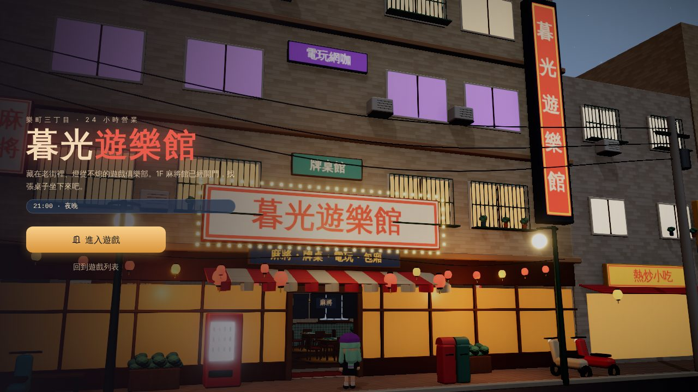 |
| 街口全景・傍晚 | 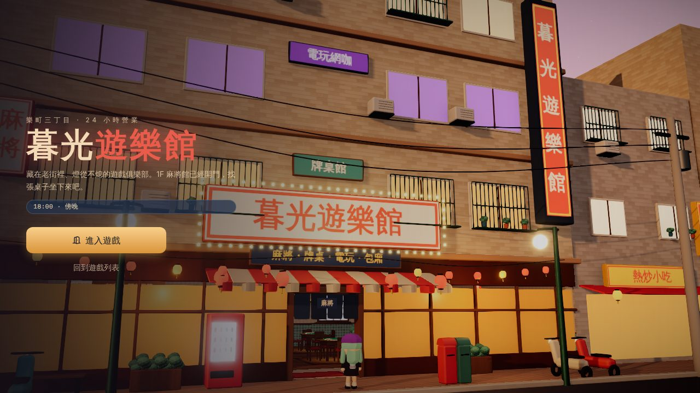  |
| 街口全景・白天 | 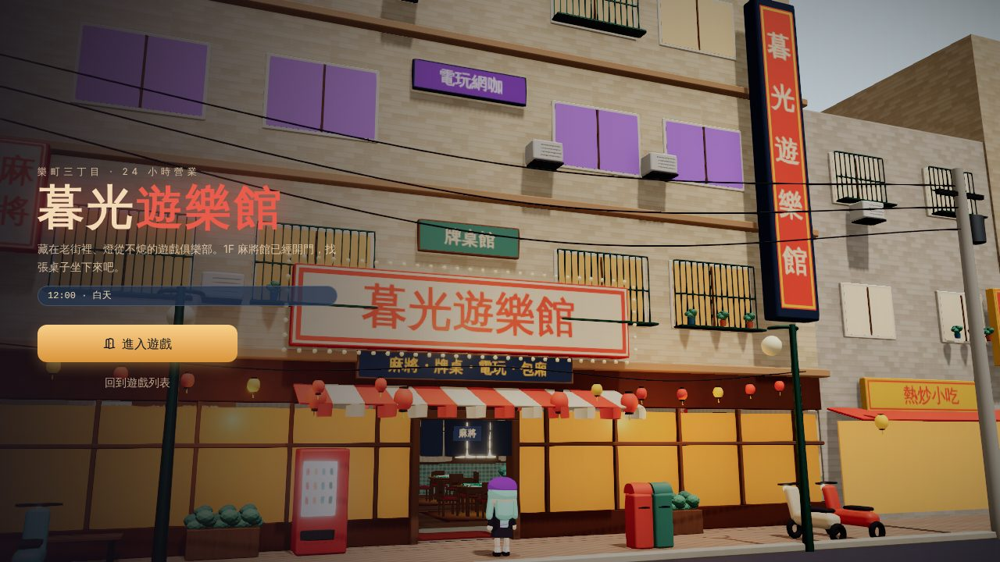   |
| 店門近景・夜晚 | 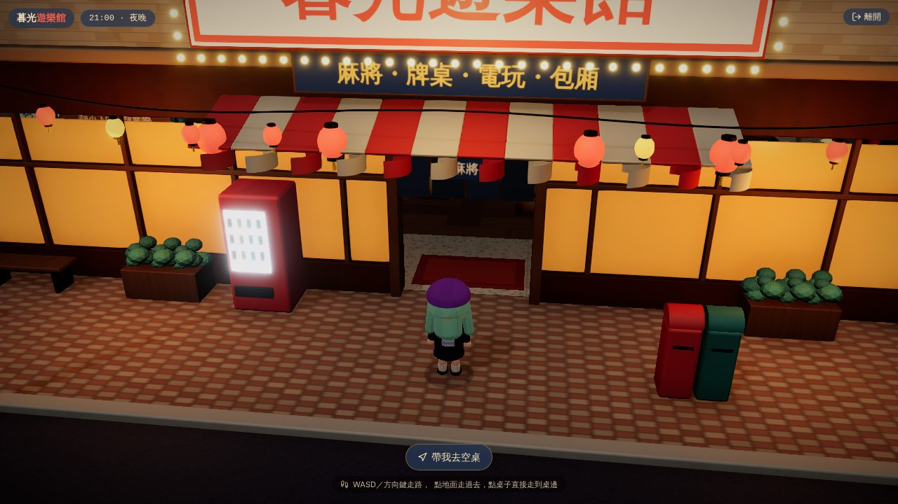   |
| 店門近景・傍晚 | 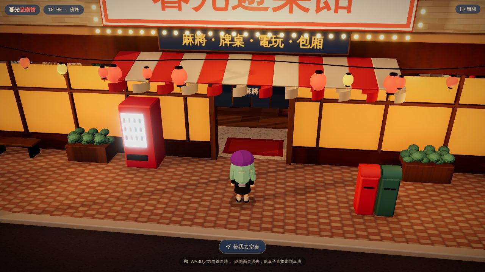    |
| 手機首頁       | 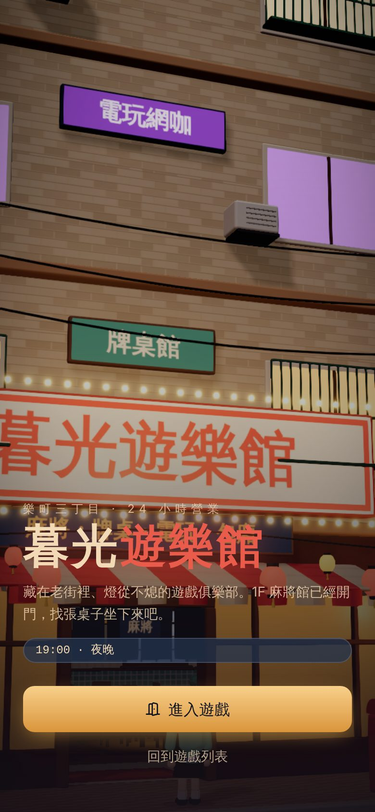 |

### 0.3 問題與優先順序（最優先的 10 項）

| #   | 問題                                                                           | 原因                                     | 涉及檔案                         | 優先 | Phase 1 處理                                                 |
| --- | ------------------------------------------------------------------------------ | ---------------------------------------- | -------------------------------- | ---- | ------------------------------------------------------------ |
| 1   | 建築、道具、角色都是基本幾何體拼裝，輪廓與細節都像積木                         | 沒有 GLB 資產與製作流程                  | Street / MahjongHall / Character | P0   | 建立資產插槽與規格；**模型本身仍缺**（見 ASSET_MANIFEST §2） |
| 2   | 首頁構圖：桌機選單蓋住大樓左 1/3；手機主招牌被切掉、選單壓在招牌上，看不到街道 | 開場鏡頭只有一組、太近，沒有考慮選單位置 | ClubScene（CameraRig）           | P0   | 已改：桌機／手機兩組構圖 + view offset 安全區                |
| 3   | 1F 櫥窗是整片不透明的橘色發光方塊，看不到後面已經做好的麻將館                  | `Glow` 方塊                              | Street（ClubFacade）             | P0   | 已改：透明玻璃 + 環境反射，看得到室內                        |
| 4   | 樓上與鄰居的窗是平面發光色塊（紫、黃），沒有深度                               | `Glow` 方塊                              | Street（Window、Shophouse）      | P1   | 已改：室內映射窗（房間深度、吸頂燈、窗簾、玻璃反射）         |
| 5   | 材質只有顏色，沒有法線與粗糙度，地面、外牆像塑膠                               | canvas 單張 albedo                       | textures.ts、Street              | P1   | 已改：4 組 PBR 貼圖（albedo + normal + ORM）                 |
| 6   | 反射與環境光不隨時段改變，夜晚金屬與玻璃映出白天的白光                         | 固定 3 片 Lightformer                    | ClubScene（DayNight）            | P1   | 已改：依時段重建的街景環境貼圖                               |
| 7   | 傍晚和白天幾乎分不出來（主光太弱、霓虹太亮）                                   | `clock.ts` 傍晚參數                      | clock.ts                         | P1   | 已改：低角度橘紅主光 2.8、天頂紫、霓虹 0.6                   |
| 8   | 路燈只有發光燈泡，地上沒有光                                                   | 沒有局部光                               | Street（StreetLamp）             | P2   | 已改：4 盞不投影的聚光燈                                     |
| 9   | 陰影範圍固定在原點 36m，角色走到街尾陰影變粗或消失                             | 陰影相機不跟隨                           | ClubScene                        | P2   | 已改：跟隨角色、30m、以 texel 對齊防閃                       |
| 10  | 中畫質照樣跑一次強度 0 的 AO；Bloom 門檻 0.85 讓被照亮的米白牆也泛白           | 後處理設定                               | Effects.tsx                      | P2   | 已改：中畫質不建立 AO pass；Bloom 門檻 0.95                  |

其他（不在這一輪）：角色是球體＋膠囊（Phase 3）、1F 室內家具與燈光（Phase 2）、室外鏡頭沒有遮擋處理（目前構圖下不會被屋簷擋，但 GLB 換上後要重驗）、貼圖還沒有 KTX2 壓縮。

---

## Phase 1：街口品質樣板

### 1.1 實際修改

| 檔案                                                    | 修改                                                                                                       |
| ------------------------------------------------------- | ---------------------------------------------------------------------------------------------------------- |
| `apps/web/scripts/club-textures.py`（新）               | PBR 貼圖產生器：FFT 週期雜訊、無縫、固定種子，輸出 albedo / normal / ORM WebP                              |
| `apps/web/public/club/textures/*`（新）                 | asphalt（含積水）、arcade_tile、facade_tile、concrete 四組，共約 1.4MB                                     |
| `apps/web/src/components/club/pbr.ts`（新）             | 非同步載入 PBR 組、依公尺算重複次數、同組共用 GPU 貼圖                                                     |
| `apps/web/src/components/club/InteriorWindow.tsx`（新） | 室內映射窗 shader；可被 Bake 合併；燈光跟日夜時鐘                                                          |
| `apps/web/src/components/club/assets.tsx`（新）         | 資產插槽：manifest 標 ready 就載入 GLB，否則顯示暫代模型；載入失敗自動退回；`?assets=debug`                |
| `Street.tsx`                                            | 地面／緣石／排水溝改 PBR；外牆改二丁掛 PBR；櫥窗改透明玻璃；窗戶改室內映射；路燈聚光；主要模型包進資產插槽 |
| `ClubScene.tsx`                                         | 開場構圖（桌機／手機 + view offset 安全區、推鏡時內插）；時段環境貼圖；陰影跟隨                            |
| `Effects.tsx`                                           | 中畫質不建 AO；Bloom 門檻 0.95                                                                             |
| `clock.ts`                                              | 傍晚預設                                                                                                   |
| `Bake.tsx`                                              | 合併條件加上 normal / roughness / AO 貼圖；允許標記為 bakeable 的 shader 合併                              |

### 1.2 Before / After

| 鏡頭           | Before                                               | After                                               |
| -------------- | ---------------------------------------------------- | --------------------------------------------------- |
| 街口全景・夜晚 |  | 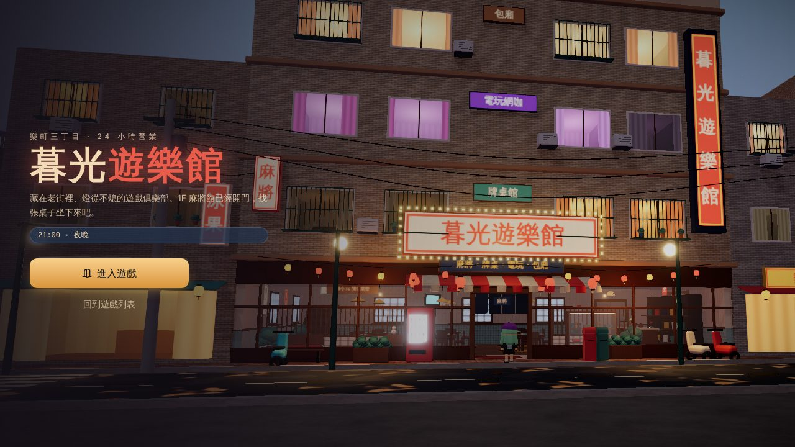 |
| 街口全景・傍晚 |   | 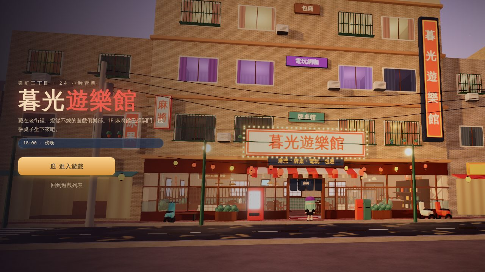  |
| 街口全景・白天 |    | 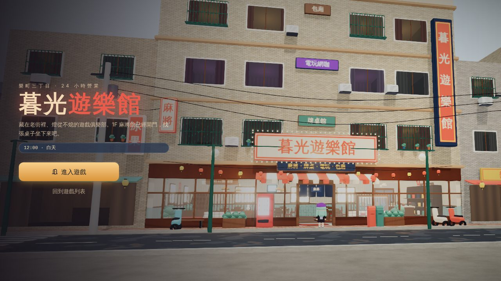   |
| 店門近景・夜晚 |    | 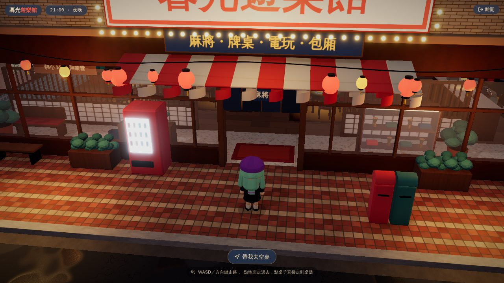   |
| 店門近景・傍晚 |     | 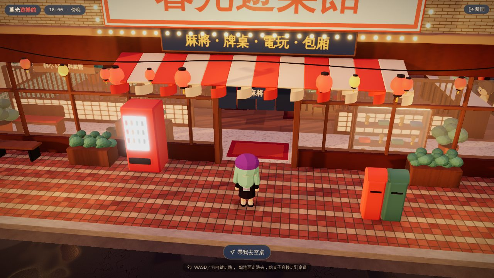    |
| 手機首頁       |  | 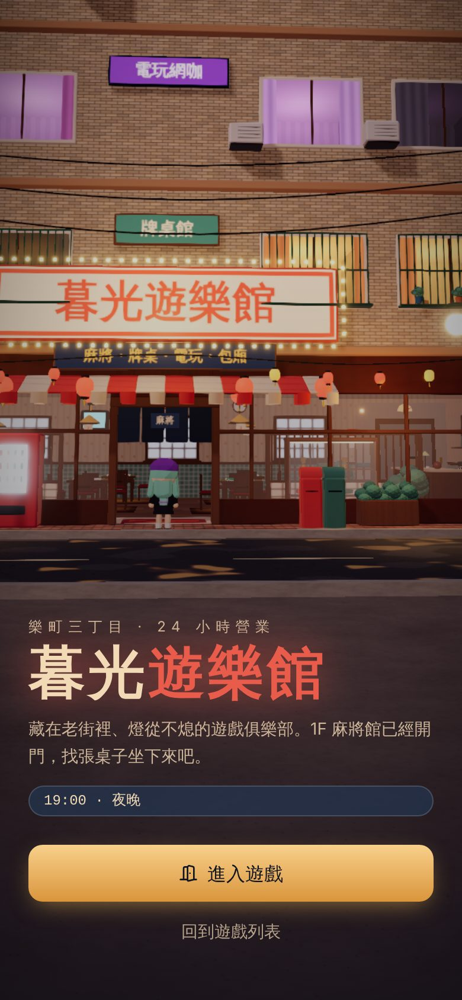 |

### 1.3 效能

測試環境：雲端容器、**沒有 GPU**（Chromium 內建 SwiftShader 軟體渲染），1280×720、`?q=high&perf=1`，數值取載入 15 秒後。
軟體渲染下 FPS 只有 0.4～0.5，前後差異在誤差內，**不能代表實機效能**；draw call 與三角面數跟硬體無關，可以比較。

| 鏡頭           | Draw calls（前 → 後） | 三角面（前 → 後） | 貼圖數  | Shader 程式 |
| -------------- | --------------------- | ----------------- | ------- | ----------- |
| 街口全景・夜晚 | 488 → 470             | 278,023 → 278,141 | 80 → 88 | 38 → 41     |
| 街口全景・傍晚 | 471 → 519             | 277,819 → 284,099 | 80 → 88 | 38 → 41     |
| 街口全景・白天 | 469 → 468             | 277,819 → 278,141 | 80 → 88 | 37 → 40     |
| 店門近景・夜晚 | 439 → 471             | 274,833 → 279,831 | 81 → 88 | 38 → 41     |
| 店門近景・傍晚 | 467 → 470             | 275,059 → 279,751 | 81 → 88 | 38 → 41     |

- 室內映射窗合併成每種窗一個 draw call，抵銷了新增的玻璃與材質；傍晚全景多出的約 50 次來自陰影相機改成跟隨角色後，開場時框進了較多投影物件。
- 中畫質少了一整個 AO pass（之前強度 0 仍在計算）。
- 新增下載約 1.4MB（WebP）。GPU 記憶體：9 張 1024² + 3 張 512² 未壓縮貼圖（含 mipmap）約 54MB，手機偏重，下一步改 KTX2／低畫質降到 512²。
- 仍高於 ART_BIBLE_LOBBY §8 的 350 draw call 預算；大宗是拼裝模型的零件（招牌、燈泡、燈籠、鐵窗），換成 GLB 後會合併。

### 1.4 功能回歸

| 項目                                    | 方法                                                    | 結果 |
| --------------------------------------- | ------------------------------------------------------- | ---- |
| 開場 → 進入遊戲 → 走進 1F → 入座 → 離桌 | `e2e/club.spec.ts`（desktop-chromium、mobile-chromium） | 通過 |
| 首頁進入麻將館                          | 同上                                                    | 通過 |
| 碰撞、尋路、互動點、日夜時鐘            | `club.test.ts` 單元測試（layout.ts 沒有修改）           | 通過 |
| 型別檢查                                | `pnpm typecheck`                                        | 通過 |
| 開場推鏡                                | 截圖：view offset 與 fov 在 2 秒推鏡內回到跟隨鏡頭      | 正常 |

### 1.5 未達標項目

1. **建築與道具仍是暫代幾何體。** 俱樂部外觀、四棟鄰居、路燈、機車、販賣機、郵筒都已接上資產插槽，但 GLB 還沒做；依規範這一輪**不能算完成精緻美術**。缺件與規格見 ASSET_MANIFEST §2。
2. **街道深度**：仍是一條直街，沒有轉角與巷口；需要 `ARCH_*` kit 才能做出轉角立面（程式拼裝不會解決問題）。
3. **貼圖是程式繪製的 v1**：有法線與粗糙度，但細節偏規則；建議換成 Substance 或 CC0 掃描素材（這個環境連不到 Poly Haven／ambientCG，沒辦法直接下載）。
4. **反射**：積水與玻璃反射的是環境貼圖（街景色塊），不是真正的招牌倒影；即時平面反射或 SSR 成本高，依規範不當預設。
5. **效能數據沒有 GPU 實測**：這次只有軟體渲染，FPS 沒有參考價值；draw call 仍高於 ART_BIBLE §8 的 350 預算，主要來自拼裝模型的零件數，換成 GLB 後會大幅下降。需要在實機（桌機 1080p、中階筆電、手機）各跑一次 `?perf=1`。貼圖還沒有 KTX2 壓縮。
6. 招牌固定架、排水管、陽台、雨痕 decal 等立面細節需要跟 `ARCH_club_facade` 一起做。
